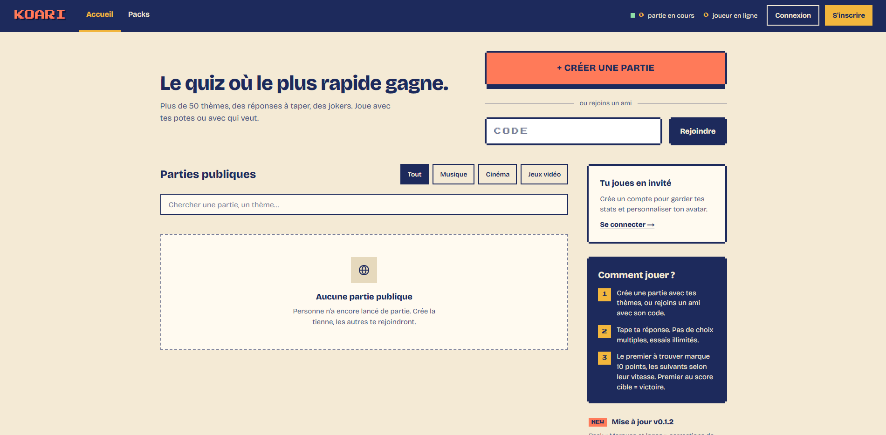
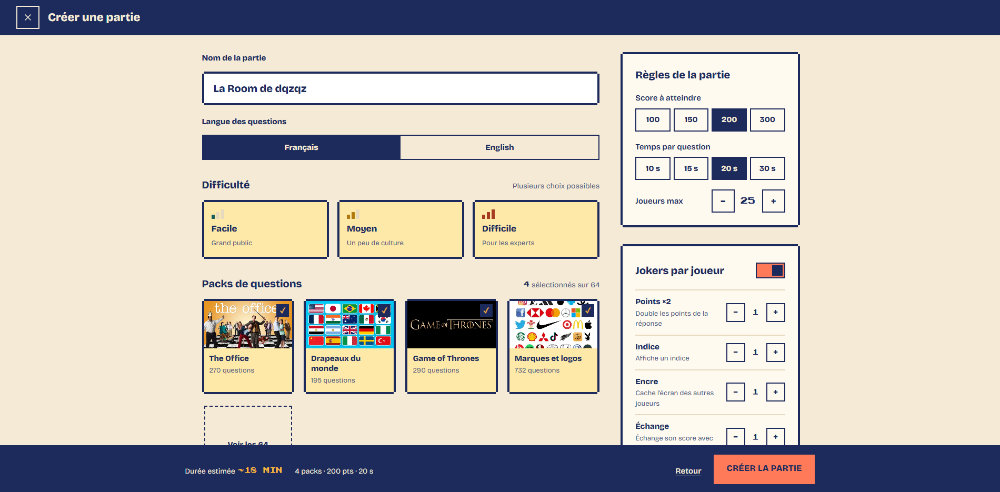
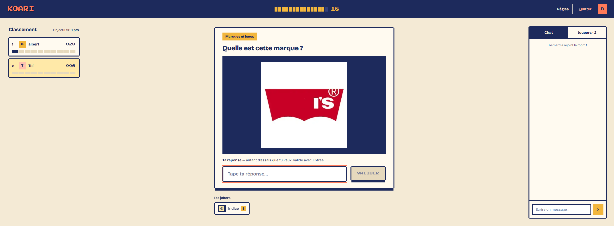
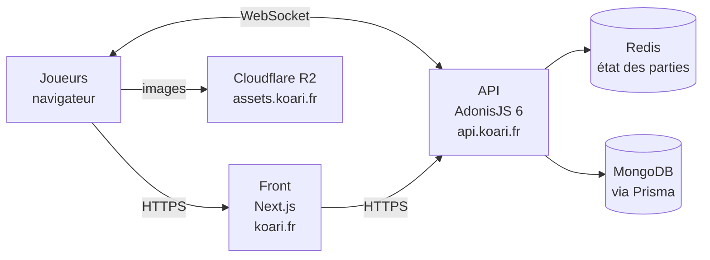

<!-- Remplace par le chemin de ton logo une fois uploadé dans le repo -->

# Koari

**Le quiz multijoueur en temps réel où il faut taper la bonne réponse avant les autres.**

---

## Sommaire

- [Le concept](#le-concept)
- [Comment on joue](#comment-on-joue)
- [Les jokers](#les-jokers)
- [Les packs de questions](#les-packs-de-questions)
- [Aperçu](#aperçu)
- [Architecture technique](#architecture-technique)
- [Défis techniques relevés](#défis-techniques-relevés)
- [Plateforme d'administration](#plateforme-dadministration)
- [Infrastructure & déploiement](#infrastructure--déploiement)
- [Pourquoi le code n'est pas ici](#pourquoi-le-code-nest-pas-ici)
- [Auteur](#auteur)

---

## Le concept

Koari est un jeu de quiz multijoueur en ligne, jouable directement dans le navigateur, sans inscription ni installation. Tu crées une partie, tu partages le lien à tes potes, et c'est parti.

Ce qui le distingue d'un quiz classique : **pas de QCM**. Les réponses se tapent en texte libre, avec des tentatives illimitées. Il ne suffit pas de reconnaître la bonne réponse parmi quatre, il faut la trouver — et vite.

Le jeu s'adresse à tout le monde : soirées entre amis, apéro en visio, pause au boulot, ou session en famille.

## Comment on joue

1. **Un joueur crée une partie** et choisit les packs de questions.
2. **Les autres rejoignent** via le lien ou le code de la partie.
3. **À chaque question**, tout le monde tape sa réponse en même temps. On peut retenter autant de fois qu'on veut tant que le chrono tourne.
4. **Le score** :
   - le **premier** joueur à trouver la bonne réponse remporte **10 points** ;
   - les suivants gagnent des points **selon le temps** qu'ils ont mis à répondre.
5. À la fin, le classement désigne le grand gagnant.

## Les jokers

Les jokers ajoutent une couche de stratégie (et de mauvaise foi) à chaque partie :

| Joker | Effet |
|---|---|
| 💡 **Indice** | Révèle un indice sur la réponse de la question en cours. |
| 🔁 **Swap de score** | Échange ton score avec celui d'un autre joueur choisi au hasard. |
| ✖️2 **Points doublés** | Double les points gagnés sur la question. |
| 🙈 **Blocage de vision** | Masque la question à tous les adversaires. |

<!-- Vérifie que les descriptions correspondent exactement au comportement en jeu -->

## Les packs de questions

Koari propose aujourd'hui **plus de 60 packs thématiques**, pour tous les goûts. Quelques exemples :

- 🌍 **Culture** : culture générale, histoire, mythologie, drapeaux
- 🎬 **Pop culture** : animés, Disney, Harry Potter, Les Simpson, The Office, Pokémon
- 🎵 **Musique & web** : rap français, YouTube français
- ⚽ **Sport** : football, tennis, rugby
- 🎲 **Formats originaux** : emoji-quiz, vrai ou faux, en quelle année

Les questions sont conçues pour **ne pas vieillir** : on évite les données volatiles (classements actuels, records en cours…) qui rendraient une réponse fausse quelques mois plus tard. Les images utilisées proviennent de sources libres de droits (Wikimedia Commons, domaine public).

## Aperçu

<!-- Ajoute tes captures d'écran / GIF ici -->

| Accueil | Création de partie | En jeu |
|---|---|---|
|  |  |  |

## Architecture technique

Koari est découpé en deux applications indépendantes (front et API), qui communiquent en HTTP pour les actions classiques et en **WebSocket** pour tout ce qui se passe en temps réel pendant une partie.

| Couche | Techno | Rôle |
|---|---|---|
| Front | **Next.js** (TypeScript) | Interface de jeu, lobby, création de partie |
| Back | **AdonisJS 6** (TypeScript) | API REST, logique de jeu, serveur WebSocket |
| Temps réel | **WebSockets** | Synchronisation des joueurs, chrono, réponses, jokers |
| État des parties | **Redis** | Stockage rapide de l'état des salles en cours |
| Données | **MongoDB** + **Prisma** | Questions, packs, statistiques |
| Validation | **Zod** | Schémas centralisés partagés pour typer et valider les données |
| Médias | **Cloudflare R2** | Hébergement des images (converties en WebP) |
| Conteneurs | **Docker** | Environnements reproductibles en dev comme en prod |

## Défis techniques relevés

Quelques problèmes concrets rencontrés pendant le développement, et comment ils ont été résolus :

**⏱️ Un chrono qui ne dérive pas.**
Les navigateurs ralentissent les timers des onglets en arrière-plan, ce qui désynchronisait les comptes à rebours entre joueurs. Le chrono a été réécrit pour s'appuyer sur des **timestamps absolus** envoyés par le serveur plutôt que sur un décompte local : chaque client recalcule le temps restant à partir de l'heure de fin, quel que soit l'état de l'onglet.

**🧩 Un typage fiable de bout en bout.**
Une erreur de type de retour sur la récupération des salles provoquait une cascade d'erreurs TypeScript dans tout le projet. La solution a été d'adopter une approche **par schémas Zod centralisés**, qui servent à la fois de source de vérité pour les types et de validation à l'exécution.

**🗄️ Prisma + MongoDB.**
Mise au point de l'intégration Prisma avec MongoDB, notamment des incohérences silencieuses sur les identifiants `@db.ObjectId` qui faisaient échouer des requêtes sans erreur explicite.

## Plateforme d'administration

Pour gérer le contenu sans toucher à la base à la main, Koari dispose d'un back-office dédié :

- **Images manquantes** : repère les questions sans image et permet d'en uploader une, automatiquement convertie en WebP.
- **Questions** : liste complète avec statistiques et filtres.
- **Problèmes détectés** : un ensemble de règles d'analyse signale les questions suspectes (incohérences, données manquantes…).

## Infrastructure & déploiement

| Élément | Choix |
|---|---|
| Hébergement | VM ARM Oracle Cloud Infrastructure (Always Free) |
| Reverse proxy & HTTPS | Caddy |
| Conteneurisation | Docker |
| DNS & CDN | Cloudflare |
| Stockage d'images | Cloudflare R2 (`assets.koari.fr`) |
| Domaines | `koari.fr` (front) · `api.koari.fr` (API) |

## Pourquoi le code n'est pas ici

Ce dépôt sert de **vitrine** au projet : il présente le jeu, ses fonctionnalités et ses choix techniques. Le code source (front et back) vit dans des dépôts privés séparés.

Pour une démo, une question technique ou un échange autour du projet, n'hésite pas à me contacter.

## Auteur

**Benjamin** — étudiant en Master Ingénierie Logicielle à l'Université de Rennes.

<!-- Ajoute tes liens -->
- 💼 LinkedIn : [Mon profil](https://www.linkedin.com/in/benjamin-conseil/)
- 🐙 GitHub : [Mon compte](https://github.com/conseil-benjamin)
- ✉️ Contact : conseil.benjamin55@gmail.com

---

**[▶️ Jouer à Koari](https://koari.fr)**

